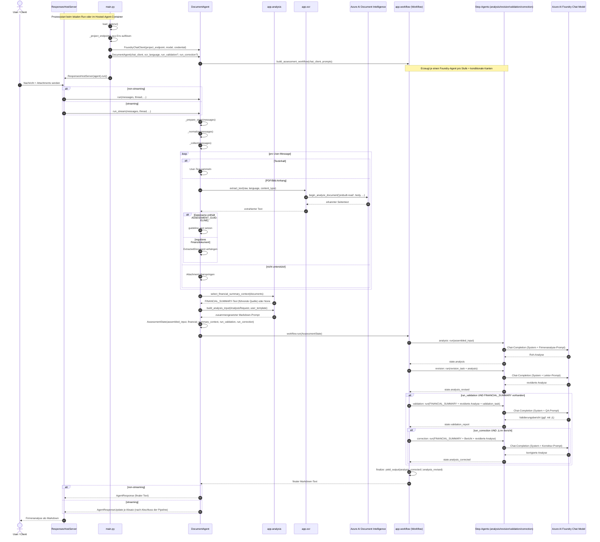

# Agent Invocation Sequence Diagram

Das folgende Mermaid-Sequenzdiagramm zeigt den tatsächlichen Workflow eines Aufrufs für den Hosted Agent in `src/document-agent`.

Der Agent nutzt seit dem Umbau einen **mehrstufigen Foundry-Multi-Agent-Workflow**
(`app/workflow.py`) statt eines einzelnen Inner-Agents. Er bildet die originale
AWS-Pipeline (`generate_leasing_credit_assessment.py`) nach:
`analysis → revision → (validation) → (correction) → finalize`.

## Kurzfassung des Flows

1. `main.py` initialisiert Foundry-Client, `DocumentAgent` und den `ResponsesHostServer`. `DocumentAgent` baut dabei einmalig den mehrstufigen Workflow (`build_assessment_workflow`) mit je einem Foundry-Agent pro Stufe.
2. Der Host empfängt eine User-Nachricht samt Anhängen und ruft `DocumentAgent.run(...)` oder `run_stream(...)` auf.
3. `DocumentAgent._prepare_state(...)` normalisiert die Nachrichten, trennt Text von binären Attachments und wählt das FINANCIAL_SUMMARY-Dokument als führende Datenquelle aus.
4. PDFs und Bilder werden über `app.ocr` an Azure AI Document Intelligence (`prebuilt-read`) geschickt.
5. Die OCR-Ergebnisse werden mit User-Text und Prompt-Templates in `app.analysis` zu einem `AssessmentState` (inkl. `assembled_input`, `financial_summary_context`, `run_validation`, `run_correction`) zusammengesetzt.
6. Der Workflow durchläuft die Stufen **analysis → revision → (validation) → (correction) → finalize**. Jede Stufe ist ein eigener Foundry-Agent mit eigener Persona/Prompt. Validierung und Korrektur laufen nur über **konditionale Kanten**: Validierung nur bei aktiviertem `run_validation` und vorhandenem FINANCIAL_SUMMARY-Dokument, Korrektur nur bei aktiviertem `run_correction` und einer `⚠️`-Markierung im Validierungsbericht.
7. `finalize` gibt die beste verfügbare Analyse zurück (korrigiert, sonst revidiert). Das Ergebnis wird als `AgentResponse` (non-streaming) bzw. absatzweise als `AgentResponseUpdate` (streaming, nach Abschluss der Pipeline) an den Client zurückgegeben.
