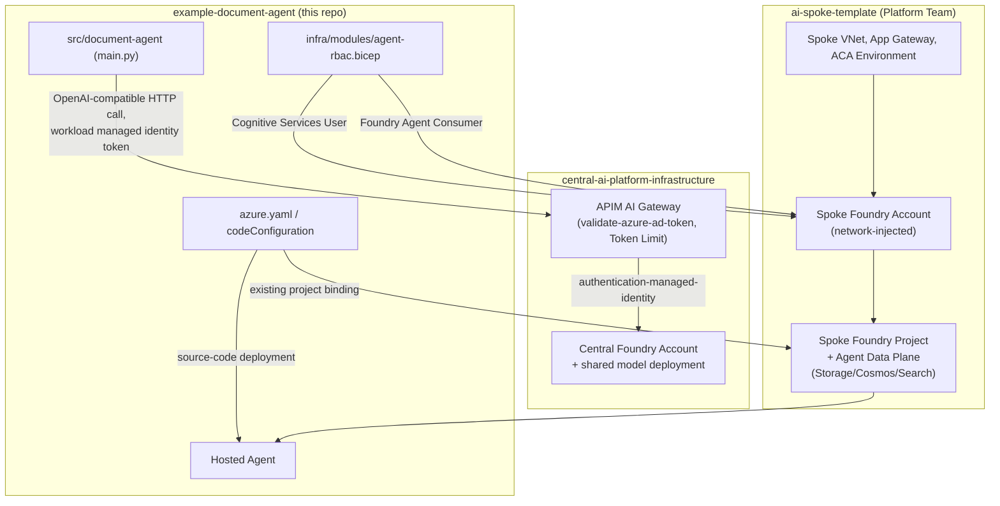

# Infrastruktur und RBAC

Dieses Repository ist die **Agent-Application-Komponente** im 3-Repo-Modell
aus `01_PLATFORM_MODEL_FEDERATED_ARCH_v2.md`. Der komplette AI Spoke (VNet,
Application Gateway, Container Apps Environment, das spoke-eigene,
network-injected Foundry Account + Project + Agent-Data-Plane) wird vom
Platform Team über das separate Repo `ai-spoke-template` bereitgestellt
— **nicht** hier. Die aktuelle Pipeline deployt nur Agent-Quellcode in das
bestehende Foundry Project. Eine eigene Container Registry und eine
AcrPull-Rollenzuweisung sind fuer diesen Source-Code-Deployment-Weg nicht
erforderlich; die bisherigen Registry-Templates wurden entfernt.

## Application Insights

Das Spoke-Template erstellt pro Spoke eine eigene workspace-basierte
Application-Insights-Ressource und verknuepft sie mit dem zentralen LAW sowie
dem bestehenden zentralen Azure Monitor Private Link Scope. Infrastruktur-
diagnostik behaelt ihr bisheriges Ziel. Die gemeinsame LAW-Ablage ist eine
bewusste Abweichung vom getrennten Anwendungs-Workspace in der Architektur-Spec.

Das Agent-Repository erstellt diese Ressource nicht nochmals. Das Anwendungs-
Deployment nutzt den Output `appInsightsResourceId`. Das Spoke-Template erstellt
bei aktiviertem Agent-Setup ausserdem die Projektverbindung `application-insights`;
Foundry injiziert daraus die reservierte `APPLICATIONINSIGHTS_CONNECTION_STRING`.
Diese Variable nicht in der Hosted-Agent-Env-Map ueberschreiben.
Document Agent konfiguriert den Azure-Monitor-Trace-Exporter mit Entra-Authentifizierung.
Die tatsaechliche Agent Instance Identity
benoetigt dafuer `Monitoring Metrics Publisher` ausschliesslich an dieser
Application-Insights-Ressource. Private DNS und Netzwerkzugriff muessen bestehen.

Die Template-Erweiterung allein instrumentiert Anwendungen nicht. Document Agent verwendet
jetzt `app/telemetry.py` fuer den Entra-Exporter und inhaltssichere OCR-/Analyse-
Spans. Agent-Framework-Instrumentierung wird ohne sensitive Daten und ohne
Message-Events aktiviert. Die doppelte automatische Host-Konfiguration wird
deaktiviert. Runtime-Rollenzuweisung und Live-Export sind je Umgebung gesondert
nachzuweisen. Prompt-, Antwort- und Dokumentinhalte werden nicht absichtlich als
Span-Attribute oder Exception-Events erfasst.

## Ressourcenfluss

**Model-Inferenz läuft NICHT über eine Foundry-Connection auf diesem
Project.** Document Agent ist ein **Hosted Agent** — laut Architektur-Spec
("Hosted-agent feasibility") ist der Admin-Connected-Model-Mechanismus
(`<connectionName>/<modelName>`, eine `Microsoft.CognitiveServices/accounts/projects/connections`-Ressource)
**ausschließlich für Prompt Agents** dokumentiert. Stattdessen ruft der
Agent-Code (`src/document-agent/main.py`, Funktion `_gateway_chat_client`)
die zentrale APIM direkt als gewöhnlichen OpenAI-kompatiblen HTTP-Call auf,
authentifiziert mit dem **Workload Managed Identity Token** (nicht mit der
Project-Identity). Dazu wird `agent_framework.openai.OpenAIChatClient` mit
einem eigens konfigurierten `AsyncAzureOpenAI`-Client (eigener
`azure_ad_token_provider` für die Audience `api://central-ai-gateway`)
verwendet — keine Foundry-SDK-Verbindung, reiner Anwendungscode.

**Cross-Repo-Voraussetzung:** Die Workload-Managed-Identity (oder, falls
`ai-spoke-template` sie erzeugt, deren Client-ID) muss in
`central-ai-platform-infrastructure`'s `apimConfig.allowedClientApplicationIds`
eingetragen sein, sonst schlägt `validate-azure-ad-token` auf der APIM fehl.
Das kann nur das Platform Team ändern.

## Rollen

| Principal | Rolle | Scope | Zweck |
| --- | --- | --- | --- |
| Foundry Agent Instance Identity | `Cognitive Services User` | Existing **Spoke** Foundry account | Content-Understanding-Datenebene |
| Foundry Agent Instance Identity | `Foundry Agent Consumer` | Existing **Spoke** Foundry account | Agent-Runtime und Verbrauch des Hosted Agents |

Die Agent Instance Identity wird erst beim ersten Hosted-Agent-Deployment von
Foundry erzeugt. Deshalb wird ihr RBAC separat mit
[`agent-rbac.bicep`](../infra/modules/agent-rbac.bicep) nach dem ersten
Deployment angewendet.

## Sicherheitsgrenzen

- Kein Foundry Account, kein Foundry Project, keine VNet-/App-Gateway-/ACA-
  Ressourcen, kein Storage/Cosmos DB/AI Search werden in diesem Repository
  erstellt — alles davon kommt aus `ai-spoke-template`.
- Die aktuelle Pipeline erstellt keine Infrastruktur und keine RBAC-Zuweisungen.
  Sie deployt Quellcode in das bestehende Spoke-Foundry-Project.
  Separates Runtime-Onboarding bleibt davon getrennt.
- Keine API Keys oder Connection Strings werden in Pipeline oder `azure.yaml`
  hinterlegt.
- `DefaultAzureCredential` verwendet für die Laufzeit die von Foundry
  bereitgestellte Agent Instance Identity (Projektzugriff); Modell-Calls
  verwenden stattdessen das Workload-Managed-Identity-Token gegen die APIM.
